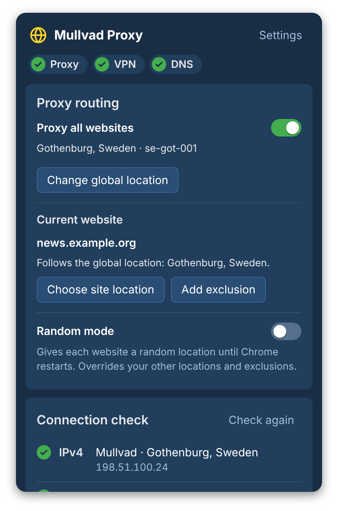
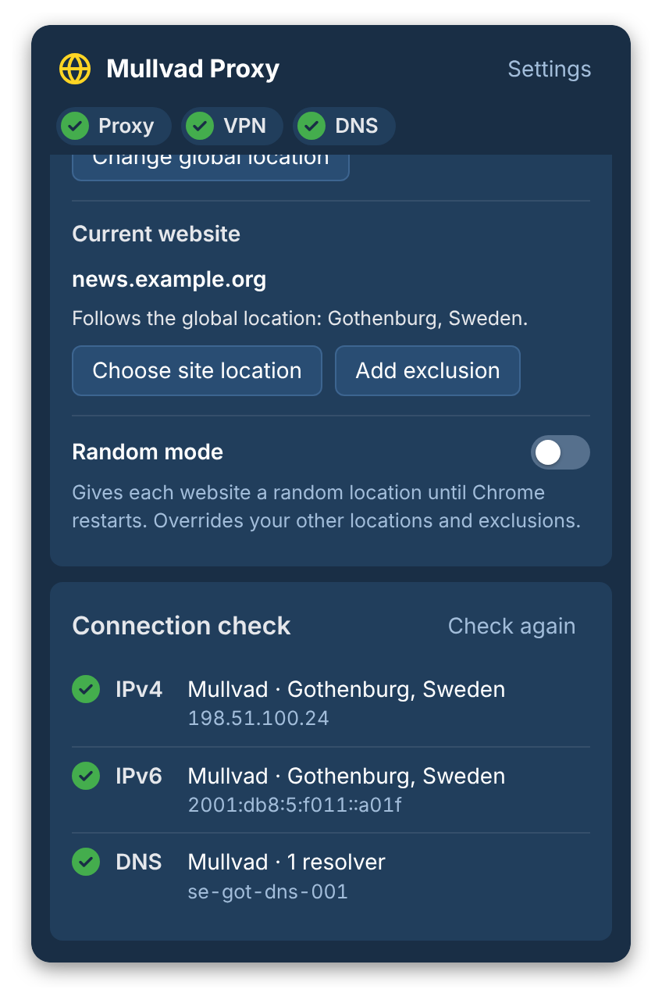
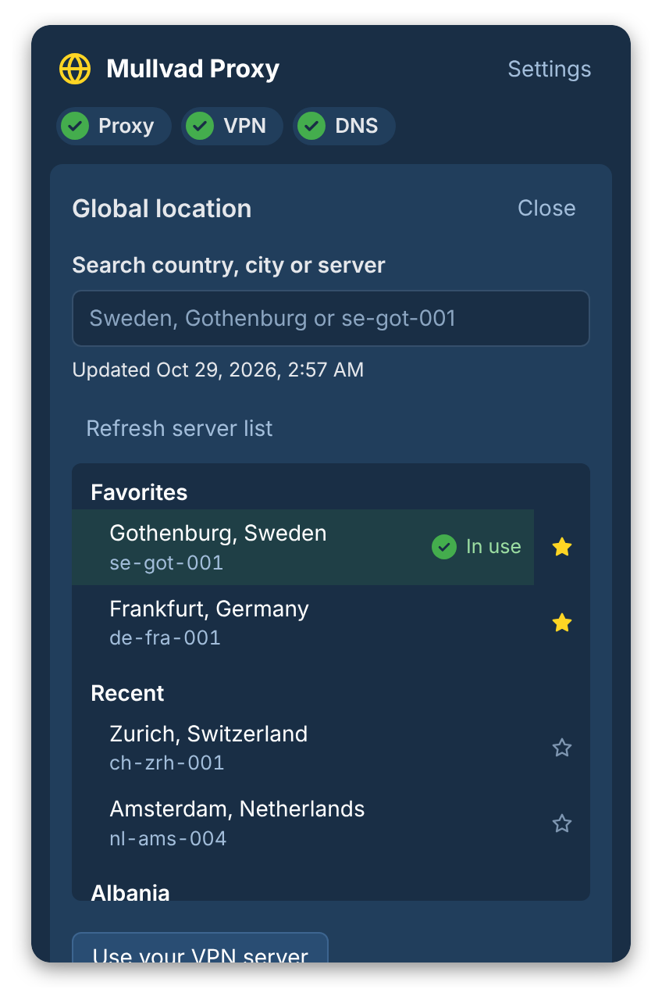
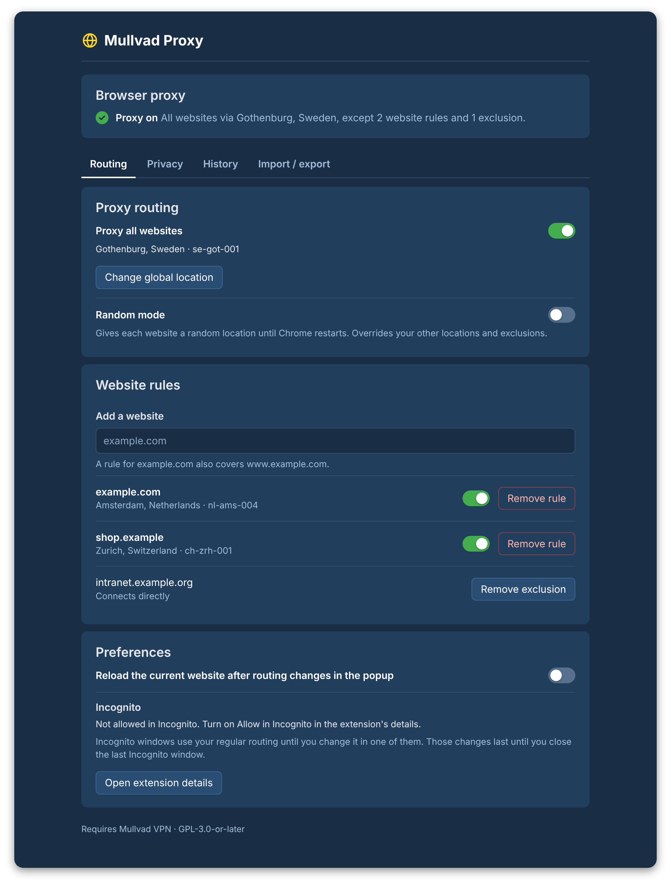

# Mullvad extension for Chrome

A Chrome Manifest V3 port of the [Mullvad browser extension](https://github.com/mullvad/browser-extension), built with React and Bun. It sends Chrome's traffic through Mullvad SOCKS5 proxies and checks your connection. The proxies work only while Mullvad VPN is connected. The extension doesn't create a VPN tunnel.

**Development preview.** This project isn't affiliated with Mullvad.

## Contents

- [Features](#features)
- [Screenshots](#screenshots)
- [Install](#install)
- [Production and development builds](#production-and-development-builds)
- [Development](#development)
- [How routing works](#how-routing-works)
- [Incognito](#incognito)
- [Development command API](#development-command-api)
- [License](#license)

## Features

- Route all websites, or the ones you pick, through a Mullvad SOCKS5 server.
- Exclude websites from the proxy, or give each website a random server until Chrome restarts.
- Check IPv4, IPv6 and DNS through Mullvad's connection check when you open the popup and after each routing change.
- Keep favorite and recent locations at the top of the location list.
- Stop WebRTC from bypassing the proxy and turn off Chrome's network prediction.
- Import settings exported from Mullvad's Firefox extension, with a preview of what changes.

## Screenshots

<p align="center">
  
  
  
</p>
<p align="center"><sub>The popup, its connection check and the location picker. The checks show example addresses.</sub></p>

<p align="center">
  
</p>
<p align="center"><sub>Routing settings and website rules on the options page.</sub></p>

## Install

1. Install [Bun](https://bun.sh) 1.4.3 or later, then build the extension:

   ```sh
   bun install --frozen-lockfile
   bun run build
   ```

2. Open `chrome://extensions`, turn on **Developer mode**, click **Load unpacked** and select `dist/production`.
3. Connect Mullvad VPN, open the extension's popup and choose a location.

After you rebuild, click the reload button on the extension's card in `chrome://extensions`.

## Production and development builds

|               | `dist/production` | `dist/development`                                           |
| ------------- | ----------------- | ------------------------------------------------------------ |
| Build command | `bun run build`   | `bun run build:dev`                                          |
| Use it for    | Everyday browsing | Working on the extension                                     |
| Minified      | Yes               | No                                                           |
| Source maps   | No                | Yes                                                          |
| Command API   | No                | Yes, see [Development command API](#development-command-api) |

> [!WARNING]
> Load `dist/development` only in a separate Chrome profile, and keep that profile's debugging port on `127.0.0.1`. Anything that reaches the port controls the whole profile and can call the command API, which changes proxy settings and returns IP addresses.

## Development

```sh
bun run check   # type check
bun run lint    # Biome lint and format check
bun run format  # apply Biome fixes
bun test        # unit and browser tests
```

The browser tests need `chromium`, `Xvfb` and `xdotool` on your `PATH`. A missing tool fails the tests instead of skipping them.

## How routing works

- Rules match each request's destination. A page that loads images or scripts from other domains sends those requests through the other domains' routes.
- A rule or exclusion for `example.com` also covers `www.example.com` and its other subdomains. One for `www.example.com` covers only that host.
- Excluded websites connect directly. Random mode overrides exclusions and your other locations.
- `localhost`, its subdomains, and private, loopback, link-local and multicast IP addresses connect directly in every mode.
- Chrome applies the routing as a mandatory PAC script with no direct fallback. When a website's proxy server is offline or gone from Mullvad's server list, that website fails to load instead of connecting directly.
- Other apps, and Chrome with the extension turned off, connect without the proxy. The extension isn't a system-wide kill switch.
- The connection check tests the route its own requests take. When the current website takes a different route, the popup says the results don't apply to it.
- Chrome's WebRTC setting blocks UDP traffic that would bypass the proxy. WebRTC itself stays on.
- Proxied websites resolve DNS through the proxy. Chrome has no per-site proxy DNS option like Firefox's, so the importer rejects Firefox exports that turn it off.

## Incognito

- To use the extension in Incognito, turn on **Allow in Incognito** in its details on `chrome://extensions`.
- Incognito windows use your regular routing until you change it from the popup in an Incognito window. Those changes last until you close the last Incognito window.
- Incognito browsing doesn't add to location history. Favorites and the reload setting come from regular windows, and you change them there.
- The connection check doesn't run in Incognito, because the extension can't make sure its requests take the Incognito route. Open [mullvad.net/check](https://mullvad.net/check) in an Incognito tab instead.

## Development command API

The development build adds `globalThis.mullvadDev` to its service worker. Its `command` method runs the same validation and controller as the popup. The production build leaves it out.

Start Chromium with a fresh profile and keep the debugging port on `127.0.0.1`:

```sh
bun run build:dev
PROFILE=$(mktemp -d)
chromium \
  --user-data-dir="$PROFILE" \
  --remote-debugging-address=127.0.0.1 \
  --remote-debugging-port=9222 \
  --disable-extensions-except="$PWD/dist/development" \
  --load-extension="$PWD/dist/development"
```

If your Chrome build ignores `--load-extension`, load `dist/development` from `chrome://extensions` in that profile.

Open the popup once to start the service worker, then list the DevTools targets:

```sh
curl --fail --silent http://127.0.0.1:9222/json/list
```

Pick the `service_worker` target whose URL ends in `/background/index.js`, connect to its `webSocketDebuggerUrl` and send:

```json
{
  "id": 1,
  "method": "Runtime.evaluate",
  "params": {
    "expression": "globalThis.mullvadDev.command({type: 'snapshot'})",
    "awaitPromise": true,
    "returnByValue": true
  }
}
```

The result is `{ "ok": true, "value": ... }` or `{ "ok": false, "error": ... }`. [`src/shared/messages.ts`](src/shared/messages.ts) lists the commands, and [`src/shared/state.ts`](src/shared/state.ts) defines the results. Commands run in the regular context unless you pass `context: "incognito"`, which also needs Allow in Incognito and an open Incognito window.

After the extension reloads or the worker restarts, look up the worker target again. Diagnostic results can contain IP addresses, so keep them private. Close the profile when you're done. The extension has no HTTP server, and websites can't reach its commands.

## License

GPL-3.0-or-later. See [LICENSE.md](LICENSE.md) and [NOTICE.md](NOTICE.md). The bundled public suffix code keeps its [MIT notice](src/core/tldts.LICENSE).
